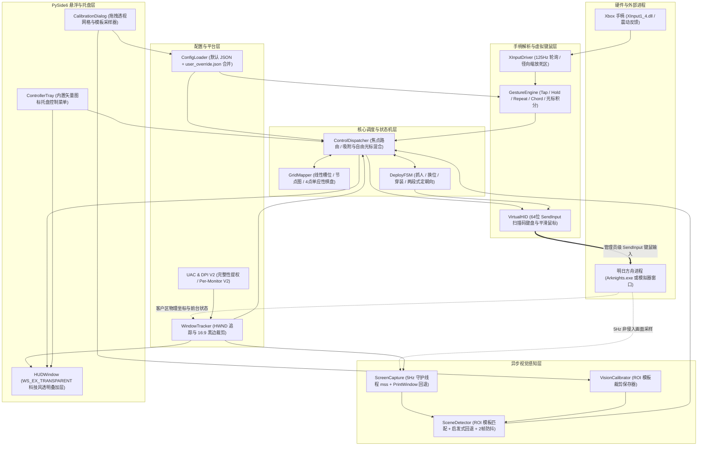
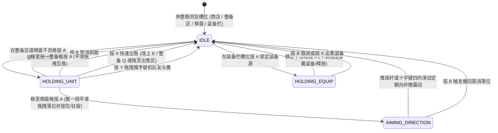

# ArkController 系统架构与核心算法说明

本文档详细阐述 **ArkController** 的模块分层、多线程与事件循环拓扑、16:9 视口与 4 点单应性透视变换算法、零注入安全边界机制，以及核心状态机设计。

---

## 1. 整体分层架构

`ArkController` 采用严格的外部非侵入式分层架构，由 **配置与平台层**、**输入与键鼠合成层**、**非侵入视觉识别层**、**核心操控调度层** 与 **PySide6 悬浮交互层** 五大子系统组成。



### 多频时钟协同调度（`main.py`）

为避免截屏与 OpenCV 模板匹配阻塞手柄操作手感，主进程通过三个解耦时钟协同运行：

| 调度单元 | 运行载体 | 周期 / 频率 | 核心职责 |
| :--- | :--- | :--- | :--- |
| `ScreenCapture` 采图线程 | 独立后台守护线程 | `~200ms` (5Hz) | 使用线程独占 `mss` 实例截取 16:9 视口并下采样至 `1280x720` BGR |
| `_vision_timer` | Qt 主线程 `QTimer` | `200ms` (5Hz) | 读取最新帧并执行 `SceneDetector.detect()` 更新稳定场景 |
| `_window_timer` | Qt 主线程 `QTimer` | `250ms` (4Hz) | 追踪游戏窗口句柄、位置尺寸及前后台切换，刷新托盘状态 |
| `_input_timer` | Qt 主线程 `QTimer` | `8ms` (~125Hz) | 轮询 XInput、驱动 `GestureEngine` 与 `ControlDispatcher`、刷新 HUD |

---

## 2. 16:9 视口归一化与 DPI V2 坐标解算

### 2.1 高分屏 Per-Monitor DPI V2 一致性

在 Windows 125% / 150% / 200% 缩放环境下，如果未开启 DPI V2 感知，Win32 窗口坐标与 `SendInput` 绝对鼠标坐标将出现错位偏移。系统在创建 `QApplication` 之前调用 `SetProcessDpiAwarenessContext(-4)`：

- `WindowTracker` 获取的客户区坐标 `(client_left, client_top, client_width, client_height)` 全部为**真实物理像素**；
- `VirtualHID` 查询虚拟桌面 `SM_XVIRTUALSCREEN` / `SM_YVIRTUALSCREEN` / `SM_CXVIRTUALSCREEN` / `SM_CYVIRTUALSCREEN` 物理边界，并将目标物理像素 `(x, y)` 线性映射至 `[0, 65535]` 发送给 `SendInput(MOUSEEVENTF_MOVE | MOUSEEVENTF_ABSOLUTE | MOUSEEVENTF_VIRTUALDESK)`；
- `HUDWindow` 通过 `align_widget_to_physical_rect` 结合 `devicePixelRatio` 与 Win32 `SetWindowPos` 将透明窗口严丝合缝贴合至游戏 16:9 物理视口。

### 2.2 异形屏黑边裁剪与锚点模式

设游戏客户区宽高为 $(W_c, H_c)$，目标标准比例 $R = 16 / 9$：

- **宽屏模式**（$W_c / H_c > 16 / 9$，例如 `2560x1080`、`3440x1440`）：
  $$W_a = \text{round}(H_c \cdot 16 / 9), \quad H_a = H_c, \quad L_a = L_c + \lfloor(W_c - W_a) / 2\rfloor, \quad T_a = T_c$$
- **高屏模式**（$W_c / H_c < 16 / 9$，例如 `2560x1600` 16:10 笔记本）：
  $$W_a = W_c, \quad H_a = \text{round}(W_c \cdot 9 / 16), \quad L_a = L_c, \quad T_a = T_c + \lfloor(H_c - H_a) / 2\rfloor$$

对于归一化点 $(u, v) \in [0, 1]^2$：
- `center_16_9`（默认）：映射到 16:9 核心视口 $(L_a + u \cdot W_a,\; T_a + v \cdot H_a)$；
- `left_edge` / `right_edge` / `top_edge` / `bottom_edge` / `client`：支持在 21:9 或 16:10 屏幕上将贴边 UI 按钮精准锚定到真实客户区边缘。

---

## 3. 4 点单应性透视棋盘变换算法

《明日方舟》卫戍协议战场采用倾斜 3D 透视视角，棋盘在 2D 屏幕上呈现**上窄下宽的等腰/微斜梯形**，若使用简单均匀网格划分，远端行与边角列会产生明显点击偏差。

`PerspectiveBoardMapper` 采用计算机视觉中的 **2D 射影单应性变换（Homography）**：

1. **建立对应点集**：将理想单位棋盘正方形四角
   $$P_{\text{unit}} = \{(0, 0), (1, 0), (1, 1), (0, 1)\}$$
   与校准后的游戏棋盘四角归一化坐标
   $$P_{\text{quad}} = \{p_{\text{TL}}, p_{\text{TR}}, p_{\text{BR}}, p_{\text{BL}}\}$$
   通过 `cv2.getPerspectiveTransform(src, dst)` 求解唯一可逆的 $3 \times 3$ 单应性矩阵 $H$ 及逆矩阵 $H^{-1}$。
2. **正向格心与格框投影**：对于 $R \times C$ 棋盘（默认 $5 \times 9$）上的任意格 $(r, c)$：
   - 格心在单位平面为 $(s, t) = \left(\frac{c + 0.5}{C},\; \frac{r + 0.5}{R}\right)$；
   - 经齐次投影：
     $$\begin{bmatrix} x' \\ y' \\ w' \end{bmatrix} = H \begin{bmatrix} s \\ t \\ 1 \end{bmatrix}, \quad (u, v) = \left(\frac{x'}{w'},\; \frac{y'}{w'}\right)$$
   - 同理对四个角 $\left(\frac{c}{C}, \frac{r}{R}\right)$ 等投影即可获得与 3D 透视完全贴合的四边形多边形 `cell_polygon(r, c)`，直接供 HUD 渲染透视高亮框。
3. **逆向光标拾取**：给定任意屏幕归一化坐标 $(u, v)$，经 $H^{-1}$ 反投影回单位正方形 $(s, t)$，即可 $O(1)$ 定位所在格 `(row, col)` 或在自由光标切回吸附模式时无缝定位最近地块。

---

## 4. 零注入安全边界与穿透设计

| 安全与稳定维度 | 实现机制 |
| :--- | :--- |
| **零内存/零注入** | 严禁调用 `OpenProcess` 读写内存、DLL 注入或 Hook 游戏进程；仅使用公开 Win32 输入与窗口查询 API |
| **UIPI 权限合规** | 通过标准 UAC 提权与官方 PC 客户端（`Arknights.exe`）对齐完整性级别，避免任何绕过安全检查的行为 |
| **64 位 SendInput 对齐** | `VirtualHID` 在 `ctypes.Union` 中完整定义 `MOUSEINPUT`、`KEYBDINPUT`、`HARDWAREINPUT`，确保 64 位 Windows 下 `ctypes.sizeof(INPUT) == 40`，并使用 `MapVirtualKeyW` 发送硬件扫描码（`KEYEVENTF_SCANCODE`） |
| **HUD 绝对不抢焦点** | `HUDWindow` 同时启用 Qt `WindowTransparentForInput` + `WA_ShowWithoutActivating` 与 Win32 `SetWindowLongW(GWL_EXSTYLE, WS_EX_LAYERED \| WS_EX_TRANSPARENT \| WS_EX_NOACTIVATE \| WS_EX_TOPMOST)`，确保所有真实与合成点击 100% 穿透至游戏窗口 |
| **失焦自动挂起** | `ControlDispatcher` 在每帧核对 `viewport is not None and viewport.is_foreground`，游戏切出前台或暂停时立刻隐藏 HUD 并停止所有键鼠模拟 |

---

## 5. 双层场景识别与防抖流水线

`SceneDetector` 采用**“模板优先 + 启发式安全回退 + 连续帧防抖”**三级架构：

1. **局部 ROI 模板匹配层**：扫描 `assets/templates/` 中的 `<scene>.png` 与配套 `.json`（含 `roi_norm`、`threshold`、`search_padding`），在限定局部窗口内运行 `cv2.matchTemplate(..., cv2.TM_CCOEFF_NORMED)`（默认阈值 `0.82`），并过滤零方差纯色图像避免伪高分。
2. **启发式视觉特征回退层**：在用户尚未采集本机模板时自动接管——通过边缘暗化遮罩 + 中央等距亮卡片识别 `MODAL_CHOICE`（并自动估算 2/3/4 选一卡片数），通过底部 10 槽周期性边缘频谱 + 右下角高亮准备区/顶部作战波次条区分 `BATTLE_PREP` 与 `BATTLE_COMBAT`；特征置信度不足时一律保守返回 `UNKNOWN_FREE_CURSOR`，绝不误锁玩家操作。
3. **连续帧防抖层**：连续 `debounce_frames = 2` 帧判定一致后才切换稳定场景，有效消除转场动画与加载黑屏引起的闪烁。
4. **不打断操作保护**：若玩家正处于干员抓取/定朝向状态，或通过 `Back` 键开启了手动锁层，调度器不会因视觉波动强行中断当前操作。

---

## 6. 核心交互状态机详解

### 6.1 干员/装备抓取与两段式定朝向状态机（`DeployFSM`）



### 6.2 组合键抑制与防误触机制（`GestureEngine`）

- **径向缩放死区（Radial Scaled Deadzone）**：对摇杆二维矢量模长 $r = \sqrt{x^2 + y^2}$ 应用平滑死区重映射，消除十字轴吸附伪影与漂移；
- **三次方双速光标积分**：$\Delta p = \text{sign}(v) \cdot |v|^{\gamma} \cdot V_{\max} \cdot \Delta t$（默认 $\gamma = 2.2, V_{\max} = 1400\text{ px/s}$），配合亚像素余量累加器实现极低速 1 像素级精调与满推高速跨屏；
- **组合键消耗标记**：当 `LT`、`RT`、`Back` 与另一按键组成 Chord（如 `LT + X`、`Back + Start`）并触发后，本次按下周期自动屏蔽修饰键与子键松开时的单独 Tap/Hold 误触发；
- **长按防误触进度反馈**：休整期按住 `Start` 时实时向 HUD 推送 `ButtonHoldProgress(0.0 ~ 1.0)` 渲染进度环，达到 `ready_hold_ms`（默认 `350ms`）才触发准备开战，中途松开立即归零取消。

---

## 7. 目录结构速览

```text
arkcontroller/
├── configs/
│   ├── default_bindings.json        # 手柄手感、防误触阈值、原生快捷键与按键映射预设
│   ├── stronghold_layout_16_9.json  # 卫戍协议 16:9 归一化全流程锚点与默认透视棋盘
│   └── user_override.json           # (运行校准后自动生成) 用户个性化覆盖配置
├── assets/templates/                # 用户采集的局部 ROI 场景识别模板 (.png + .json)
├── src/arkcontroller/
│   ├── config/                      # 强类型模型 (models.py) 与配置加载器 (loader.py)
│   ├── platform/                    # UAC / DPI V2 (uac.py) 与窗口视口追踪 (window_tracker.py)
│   ├── input/                       # XInput 驱动、手势引擎与 Win32 SendInput 合成器
│   ├── vision/                      # 异步截屏、双层场景识别与模板校准器
│   ├── control/                     # 透视网格映射、两段式部署状态机与调度中枢
│   ├── overlay/                     # PRTS 透明穿透 HUD、可视化校准向导与系统托盘
│   └── main.py                      # CLI 入口与多频事件循环装配
├── tests/                           # 6 个核心模块单元测试套件
└── docs/                            # 架构设计与手柄操作手册
```
