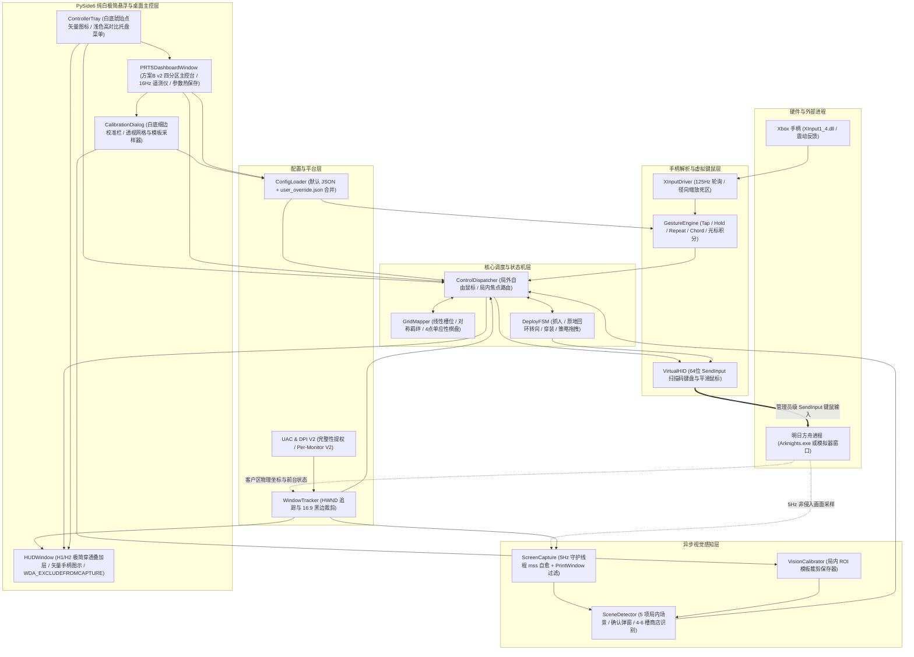
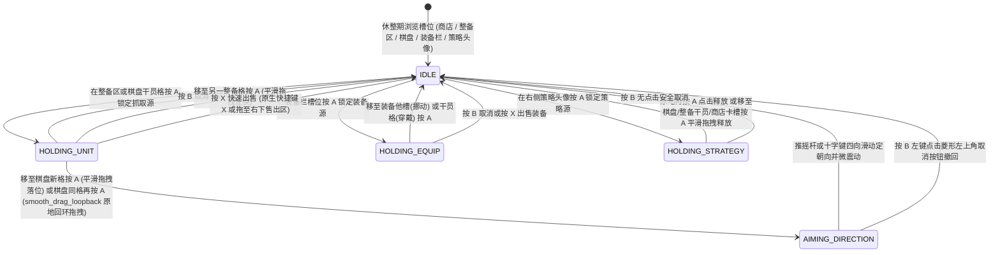

# ArkController 系统架构与核心算法说明

本文档详细阐述 **ArkController** 的模块分层、多线程与事件循环拓扑、16:9 视口与 4 点单应性透视变换算法、零注入安全边界机制，以及核心状态机设计。

---

## 1. 整体分层架构

`ArkController` 采用严格的外部非侵入式分层架构，由 **配置与平台层**、**输入与键鼠合成层**、**非侵入视觉识别层**、**核心操控调度层** 与 **PySide6 悬浮交互层** 五大子系统组成。



### 多频时钟协同调度（`main.py`）

为避免截屏、OpenCV 识别与桌面遥测刷新阻塞手柄操作手感，主进程通过解耦时钟协同运行：

| 调度单元 | 运行载体 | 周期 / 频率 | 核心职责 |
| :--- | :--- | :--- | :--- |
| `ScreenCapture` 采图线程 | 独立后台守护线程 | `~200ms` (5Hz) | 线程独占 `mss` 截取 16:9 视口下采样至 `1280x720` BGR，支持 UAC 切换后惰性重建自愈并拦截全黑伪帧 |
| `_vision_timer` | Qt 主线程 `QTimer` | `200ms` (5Hz) | 读取最新帧并执行 `SceneDetector.detect()` 更新稳定场景 |
| `_window_timer` | Qt 主线程 `QTimer` | `250ms` (4Hz) | 追踪游戏窗口句柄、位置尺寸及前后台切换，刷新托盘与主控台状态 |
| `_input_timer` | Qt 主线程 `QTimer` | `8ms` (~125Hz) | 轮询 XInput、驱动 `GestureEngine` 与 `ControlDispatcher`、刷新 HUD |
| `PRTSDashboardWindow` 遥测定时器 | Qt 主线程 `QTimer` | `60ms` (~16Hz) | 仅在主控台窗口可见时运行，刷新双摇杆靶盘、扳机条与按键阵列；关闭最小化至托盘后自动停止，后台零开销 |

---

## 2. 16:9 视口归一化与 DPI V2 坐标解算

### 2.1 高分屏 Per-Monitor DPI V2 一致性

在 Windows 125% / 150% / 200% 缩放环境下，如果未开启 DPI V2 感知，Win32 窗口坐标与 `SendInput` 绝对鼠标坐标将出现错位偏移。系统在创建 `QApplication` 之前调用 `SetProcessDpiAwarenessContext(-4)`：

- `WindowTracker` 获取的客户区坐标 `(client_left, client_top, client_width, client_height)` 全部为**真实物理像素**；
- `VirtualHID` 查询虚拟桌面 `SM_XVIRTUALSCREEN` / `SM_YVIRTUALSCREEN` / `SM_CXVIRTUALSCREEN` / `SM_CYVIRTUALSCREEN` 物理边界，并将目标物理像素 `(x, y)` 线性映射至 `[0, 65535]` 发送给 `SendInput(MOUSEEVENTF_MOVE | MOUSEEVENTF_ABSOLUTE | MOUSEEVENTF_VIRTUALDESK)`；
- `HUDWindow` 通过 `align_widget_to_physical_rect` 结合 `devicePixelRatio` 与 Win32 `SetWindowPos` 将透明窗口严丝合缝贴合至游戏 16:9 物理视口。

### 2.2 异形屏黑边裁剪与锚点模式

设游戏客户区宽高为 $(W_c, H_c)$，目标标准比例 $R = 16 / 9$：

- **宽屏模式**（$W_c / H_c > 16 / 9$，例如 `2560x1080`、`3440x1440`）：
  $$W_a = \text{round}(H_c \cdot 16 / 9), \quad H_a = H_c, \quad L_a = L_c + \lfloor(W_c - W_a) / 2\rfloor, \quad T_a = T_c$$
- **高屏模式**（$W_c / H_c < 16 / 9$，例如 `2560x1600` 16:10 笔记本）：
  $$W_a = W_c, \quad H_a = \text{round}(W_c \cdot 9 / 16), \quad L_a = L_c, \quad T_a = T_c + \lfloor(H_c - H_a) / 2\rfloor$$

对于归一化点 $(u, v) \in [0, 1]^2$：
- `center_16_9`（默认）：映射到 16:9 核心视口 $(L_a + u \cdot W_a,\; T_a + v \cdot H_a)$；
- `left_edge` / `right_edge` / `top_edge` / `bottom_edge` / `client`：支持在 21:9 或 16:10 屏幕上将贴边 UI 按钮精准锚定到真实客户区边缘。

---

## 3. 4 点单应性透视棋盘变换算法

《明日方舟》卫戍协议战场采用倾斜 3D 透视视角，棋盘在 2D 屏幕上呈现**上窄下宽的等腰/微斜梯形**，若使用简单均匀网格划分，远端行与边角列会产生明显点击偏差。

`PerspectiveBoardMapper` 采用计算机视觉中的 **2D 射影单应性变换（Homography）**：

1. **建立对应点集**：将理想单位棋盘正方形四角
   $$P_{\text{unit}} = \{(0, 0), (1, 0), (1, 1), (0, 1)\}$$
   与校准后的游戏棋盘四角归一化坐标
   $$P_{\text{quad}} = \{p_{\text{TL}}, p_{\text{TR}}, p_{\text{BR}}, p_{\text{BL}}\}$$
   通过 `cv2.getPerspectiveTransform(src, dst)` 求解唯一可逆的 $3 \times 3$ 单应性矩阵 $H$ 及逆矩阵 $H^{-1}$。
2. **正向格心与格框投影**：对于 $R \times C$ 棋盘（实机标准默认 $4 \times 7$）上的任意格 $(r, c)$：
   - 格心在单位平面为 $(s, t) = \left(\frac{c + 0.5}{C},\; \frac{r + 0.5}{R}\right)$；
   - 经齐次投影：
     $$\begin{bmatrix} x' \\ y' \\ w' \end{bmatrix} = H \begin{bmatrix} s \\ t \\ 1 \end{bmatrix}, \quad (u, v) = \left(\frac{x'}{w'},\; \frac{y'}{w'}\right)$$
   - 同理对四个角 $\left(\frac{c}{C}, \frac{r}{R}\right)$ 等投影即可获得与 3D 透视完全贴合的四边形多边形 `cell_polygon(r, c)`，直接供 HUD 渲染透视高亮框。
3. **逆向光标拾取**：给定任意屏幕归一化坐标 $(u, v)$，经 $H^{-1}$ 反投影回单位正方形 $(s, t)$，即可 $O(1)$ 定位所在格 `(row, col)` 或在自由光标切回吸附模式时无缝定位最近地块。
4. **五视图态镜头缩放补偿、Boss 战双态适配与动态商店左延**：
   - `LayoutProfile` 支持 `LayoutViewState` 五种视图态（`normal` / `shop_open` / `shop_open_boss` / `combat` / `unit_selected`）覆写、内置默认回退与 `ViewportTransform` 仿射缩放平移补偿：
     - `shop_open`：普通关卡开店镜头左移缩小补偿（`offset_u=-0.02889`）；
     - `shop_open_boss`：Boss 战左侧正向开店水平居中补偿（`offset_u≈+0.001`，避免普通开店选框全区左偏半格，整备 `max_err=1.52px`、装备 `max_err=0.55px`）；
     - `combat`：作战期镜头推近 `~1.15x` 并右下平移补偿（含装备独立精校值，整备 `mean_err=1.25px`、装备 `max_err=0.70px`，同时作用于正向与 Boss 镜像棋盘/装备）；
   - 针对多人 Boss 战分配至右侧时 3D 棋盘与 5 槽装备台沿 `u_axis_normal ≈ 0.4709` 水平镜像（而 10 槽整备区与底部 2D 商店保持原位不变）的几何规律，`LayoutProfile` 内置实测 `mirrored_board_quad`（保持逻辑左→右列序）与 `mirrored_equip_zone`，`resolve_board_quad` / `resolve_equip_zone` 支持 `mirrored: bool = False` 关键字参数并在镜像态直接复用 `view_overrides` 缩放矩阵（跳过静态非镜像覆写），`ControlDispatcher` 预建 `mirrored in (False, True)` 双套五视图映射器按 `(view_state, board_mirrored)` 实时无损切换；
   - `equip_replace_zone` 与 `equip_replace_close` 支持干员满装备弹出「销毁并替换」2 槽面板的外扩整卡选框（`±6px`）与底部暗红按钮精确点击中心解耦；
   - `resolve_shop_zone` 与 `resolve_shop_upgrade_point` 支持商店升至二本（5 槽）与四本（6 槽）时以最右卡槽为锚点按固定步距向左动态延伸，并同步左移升级灰卡点击坐标；
   - **多选一卡片点击中心与 `+11px` 外扩选取框解耦**：`choice_zone` / `choice_2_zone` / `choice_6_top_zone` / `choice_6_bottom_zone` 严格存储官方 PC 16:9 卡片白边本体尺寸，保障 `resolve_choice_card_center` 与 `resolve_choice_confirm_point`（`cv + sh * 0.513`）零误差命中点击中心；`resolve_choice_card_polygon` 与 `resolve_choice_confirm_polygon` 则在渲染多边形层面向外扩展 `11px`（待确认态包裹放大整卡 + 底部确认白条，安全夹紧 `[0.004, 0.996]`），彻底避开卡片亮白实线边框并保障 `2×3` 上下排留足暗区净空。

---

## 4. 零注入安全边界与穿透设计

| 安全与稳定维度 | 实现机制 |
| :--- | :--- |
| **零内存/零注入** | 严禁调用 `OpenProcess` 读写内存、DLL 注入或 Hook 游戏进程；仅使用公开 Win32 输入与窗口查询 API |
| **UIPI 权限合规** | 通过标准 UAC 提权与官方 PC 客户端（`Arknights.exe`）对齐完整性级别，避免任何绕过安全检查的行为 |
| **64 位 SendInput 对齐** | `VirtualHID` 在 `ctypes.Union` 中完整定义 `MOUSEINPUT`、`KEYBDINPUT`、`HARDWAREINPUT`，确保 64 位 Windows 下 `ctypes.sizeof(INPUT) == 40`，并使用 `MapVirtualKeyW` 发送硬件扫描码（`KEYEVENTF_SCANCODE`） |
| **HUD 绝对不抢焦点 & S3 选框截屏隔离可切换** | `HUDWindow` 同时启用 Qt `WindowTransparentForInput` + `WA_ShowWithoutActivating`、Win32 `SetWindowLongW(GWL_EXSTYLE, WS_EX_LAYERED \| WS_EX_TRANSPARENT \| WS_EX_NOACTIVATE \| WS_EX_TOPMOST)` 以及 `SetWindowDisplayAffinity(hwnd, WDA_EXCLUDEFROMCAPTURE / WDA_NONE)` 热切换；选取框采用 **S3 加粗取景折角 + 四边半透细线 + 外角琥珀微刻线**（`FocusZone.BOARD` 与紧凑槽位自动切换短折角，`MODAL_CONFIRM` 选框微收防极边裁切），配合 `_has_stronghold_in_game_chrome` 顶部两翼黑条兜底，开启 `WDA_NONE` 后经全场景 26/26 压测对视觉识别零干扰 |
| **失焦自动挂起** | `ControlDispatcher` 在每帧核对 `viewport is not None and viewport.is_foreground`，游戏切出前台或暂停时立刻隐藏 HUD 并停止所有键鼠模拟 |

---

## 5. 异步采图自愈、双层场景识别与防抖流水线

### 5.1 后台截屏 UAC 自愈与黑帧防护（`ScreenCapture`）

Windows UAC 提权切回安全桌面瞬间可能导致后台线程首次初始化 `mss.mss()` 失败或已有 GDI 句柄失效，而 Unity DX11 渲染窗口下 `PrintWindow` 常返回全黑帧。`ScreenCapture` 为此建立双重防护：
- **惰性自愈**：后台 `_capture_loop` 每轮检测到 `sct is None` 时自动重试 `mss.mss()`；运行中若截屏抛异常，立即释放并置空失效 `sct`，由下一周期自动重建全新实例；
- **全黑伪帧拒绝**：当 `PrintWindow` 回退返回全黑帧（`max() == 0`）且 `mss` 也不可用时安全返回 `None`，绝不向识别器喂入假黑屏画面。

### 5.2 精简五场景双层判别器（`SceneDetector`）

自 `v0.2.0` 起，系统彻底移除易受版本改版影响的局外菜单场景与静态节点配置，`GameScene` 严格精简为 5 项局内核心状态：**`BATTLE_PREP`**、**`MODAL_CHOICE`**、**`MODAL_CONFIRM`**、**`BATTLE_COMBAT`**、**`UNKNOWN_FREE_CURSOR`**（所有局外与设置页均归入 `UNKNOWN_FREE_CURSOR`，自动由左摇杆平滑驱动自由模拟鼠标）。

`SceneDetector` 采用**“模板优先 + 零模板强特征启发式 + 连续帧防抖”**三级流水线：

1. **局部 ROI 模板匹配层**：扫描 `assets/templates/` 中的 `<scene>.png` 与配套 `.json`（含 `roi_norm`、`threshold`、`search_padding`），在限定局部窗口内运行 `cv2.matchTemplate(..., cv2.TM_CCOEFF_NORMED)`（默认阈值 `0.82`），并过滤零方差纯色图像避免伪高分。
2. **零模板 HSV 强特征与几何启发式层**：
   - **局外 100% 防误判双锚点门禁（含宽白 HUD 两翼抗遮挡）**：`BATTLE_PREP` / `BATTLE_COMBAT` 启发式分支强制校验 `_has_stronghold_in_game_chrome()`（左上深红退出门硬门禁 `esc_red >= 0.22` + 顶部中央深黑状态栏或左右两翼未被居中 HUD 覆盖黑条兜底 `wings_dk >= 0.70`），并将右上准备按钮色相收窄至真实粉红区间 `(H >= 158) | (H <= 4)`，同时要求所有弹窗分支满足 `modal_chrome`（顶部青色标题带或右侧方形收起按钮），确保局外画面 100% 保持在 `UNKNOWN_FREE_CURSOR` 且开启 `WDA_NONE` 叠加宽纯白顶签与 Toast 时绝不误跌出局内；
   - **回合结束 & `ESC` 退出确认弹窗（`MODAL_CONFIRM`）**：优先于右上角准备按钮检测，采用黑底分位数约束（`dark_ratio >= 0.82 & p80 < 30`）、左下纯灰取消带与避开右下机械剪影的暗红确认带联合判定，并通过中央上方亮像素占比输出 `confirm_has_dont_ask` 自动区分三项回合确认窗与双项 `ESC` 暂时离开窗；
   - **自适应决策弹窗（`MODAL_CHOICE`：`1x2` / `1x3` / `2x3`）**：基于 Sobel 垂直卡片边框梯度与白色「确认选择」底条检测，按 `6 选一（支持官方 PC 16:9 与旧宽屏双布局，单槽兼容未选暗卡与 1~5 张已被队友选走的均匀浅灰卡） -> 3 选一 -> 2 选一` 顺序零模板区分并实时追踪 `selected_choice_index`；二选一两翼外围检测采用按列垂直均值再取列峰（`mean(axis=0).max()`）免疫压暗雪山纹理背景；
   - **三套卫戍协议主题全适配 & 双灰商店零色相三联结构（`BATTLE_PREP` / `BATTLE_COMBAT`）**：在 `_has_stronghold_in_game_chrome()` 门禁下，`_has_real_pc_prep_banner` 同时支持主题一（紫粉准备 / 顶紫框 + 放大镜 / 左右双放大镜共现防 Toast 瞬态遮挡）、主题二（乌萨斯浅灰绿椭圆与置灰态辉光管兜底）与主题三（罗德岛青绿准备按钮 / 顶青绿八角框）；非休整横幅且右下费用栏 `◆ C` 与白色回复进度条命中（`_has_real_pc_combat_cost_bar`）时直判 `BATTLE_COMBAT (shop_open=False)`；商店展开判定在保留色相快路径外新增零色相三联结构通道（上移黑底白字横幅 + 冻结/刷新双按钮底缘梯度 + 最右 4 固定槽竖边暗缝），即使刷新与冻结双按钮同时变灰及三主题全按钮置灰仍 100% 准确识别 `shop_open=True`；动态 4/5/6 槽识别脱离顶部按钮色相门控，采用三主题商品卡底条并集、亮态/暗屏 CRT/低亮置灰升级卡分支（含左邻排斥）及抗鼠标压边 `[ NO INFO ]` 空槽判定；
   - **Boss 战左侧居中开店与右侧镜像自动检测锁存（`boss_shop_centered` / `board_mirrored`）**：针对多人 Boss 战分配至右侧时 3D 舞台水平镜像场景，`_extract_mirror_features` 与 `_observe_board_mirrored_heuristic` 在 `shop_open` / `normal` 双态提取蓝箱/电视/红门连通域特征输出三态观测并由 `_latched_board_mirrored` 防抖锁存；针对 Boss 战左侧正向开店镜头水平居中场景，`_observe_boss_shop_centered_heuristic` 在非镜像开店态扫描左侧青蓝防御箱水平位移（`x0>=344 & cx>=390` vs `x0<=336 & cx<=382`）并由 `_latched_boss_shop_centered` 锁存（遮挡保持、镜像互斥及出局清零）；
   - **满装备「销毁并替换」面板检测（`equip_replace_open`）**：`_detect_equip_replace_open_heuristic` 联合判定双暗红替换钮内框、两钮暗缝、右上 `[×]` 亮灰与深灰斜叉、面板左侧暗底、卡间暗缝与底部暗条（46/46 唯一命中且抗 `WDA_NONE` S3 选框自污染）；`ControlDispatcher` 以高于 `unit_selected` 的优先级自动锁入 `FocusZone.EQUIP_REPLACE`（附 `0.65s` 操作保护窗与 2 帧视觉关闭防抖）；
   - **任意水平滚动相位多盟约（`0~7` / `>7`）动态检测与满层高光兼容**：采用暗芯亮环 + 满层高光饱和双通道圆环评分与向量化 `2px` 局部带扫频，在 `phi ∈ [0, 80)` 内按梳状相位匹配并做单环微调 + 三重充要溢出判据，实时输出 `covenant_count`、`covenant_overflow` 与精确圆心序列 `covenant_centers_u`；`ControlDispatcher` 在 `FocusZone.TOP_INFO` 优先直接使用 `covenant_centers_u` 吸附（空元组回退公式），且可见数在 `7 ↔ 6` 波动时稳留盟约焦点不误跳右放大镜；
   - **去色相结构化表情面板检测与防逃逸锁焦**：`_detect_emote_panel_open_heuristic` 联合判定暗底 + 上/右/下三边外框 + 泛亮前景与底部居中分页点对比，兼容任意色相及稀疏末页表情；`ControlDispatcher` 配合入口/全交互 `1.8s` 续期保护锁与视觉关闭 4 帧连续防抖、屏蔽 `L3` 误按及 `cursor` 模式逃逸，确保表情翻页全程稳锁在 `FocusZone.EMOTE_PANEL`。
3. **连续帧防抖与不打断保护**：连续 `debounce_frames = 2` 帧一致后切换稳定场景；干员/装备/策略抓取与定朝向期间不强行切层。即便用户通过 `Back` 键处于**手动锁层**，只要同为 `BATTLE_PREP`、`BATTLE_COMBAT`、`MODAL_CHOICE` 或 `MODAL_CONFIRM`，`ControlDispatcher` 依然实时同步 `shop_open`、`shop_slot_count`、`board_mirrored`、`unit_selected`、`emote_panel_open`、`covenant_count`、`covenant_overflow`、`covenant_centers_u`、`has_teammates`、`choice_count`、`selected_choice_index` 与 `confirm_has_dont_ask`；当商店收起时自动将空闲 `FocusZone.SHOP` 退回 `FocusZone.BENCH` 防止残留选框。

---

## 6. 核心交互状态机详解

### 6.1 干员/装备/策略抓取、原地回环转向与两段式定朝向（`DeployFSM`）



### 6.2 组合键抑制与防误触机制（`GestureEngine`）

- **径向缩放死区（Radial Scaled Deadzone）**：对摇杆二维矢量模长 $r = \sqrt{x^2 + y^2}$ 应用平滑死区重映射，消除十字轴吸附伪影与漂移；
- **三次方双速光标积分与物理鼠标无损同步**：$\Delta p = \text{sign}(v) \cdot |v|^{\gamma} \cdot V_{\max} \cdot \Delta t$（默认 $\gamma = 2.2, V_{\max} = 1400\text{ px/s}$），配合亚像素余量累加器实现极低速 1 像素级精调与满推高速跨屏；自由鼠标模式下通过 `VirtualHID.get_cursor_pos()` 与 `>= 2px` 变化门槛同步窗口内真实物理鼠标位置（启动/重回前台/手移物理鼠标立即跟手，同时不抹零 `< 0.5px/tick` 慢速微推摇杆的亚像素累加，副屏越界自动免疫）；
- **组合键消耗标记**：当 `LT`、`RT`、`Back` 与另一按键组成 Chord（如 `LT + X`、`Back + Start`）并触发后，本次按下周期自动屏蔽修饰键与子键松开时的单独 Tap/Hold 误触发；
- **长按防误触进度反馈**：休整期按住 `Start` 时实时向 HUD 推送 `ButtonHoldProgress(0.0 ~ 1.0)` 渲染进度环，达到 `ready_hold_ms`（默认 `350ms`）才触发准备开战，中途松开立即归零取消。

---

## 7. PyInstaller 独立单文件打包与冻结环境适配

为支持零 Python 环境的绿色独立分发，系统通过 `scripts/build_exe.py` 构建无控制台单文件 `dist/ArkController.exe`（`--onefile --windowed`，嵌入多尺寸 `assets/arkcontroller.ico` 与 Windows `VSVersionInfo`，并剔除 `QtWebEngine`/`QtQml`/`QtQuick`/`Qt3D`/`QtMultimedia`/`QtPdf`/`QtSql`/`QtNetwork` 等未使用模块），在 `getattr(sys, "frozen", False)` 冻结态下执行四项运行期加固：

1. **双层配置解析（`ConfigLoader`）**：默认优先读取 `<exe_dir>/configs/`；若用户仅拷走单个 `.exe` 至空目录运行，则 `keymap_path` / `layout_path` 无缝回退读取 PyInstaller 解包目录 `_MEIPASS/configs/` 的内置默认 JSON；而 `override_path` 始终指向可写的 `<exe_dir>/configs/user_override.json`（保存时自动创建父目录并合并重载）。
2. **模板目录读写分离（`main.py`）**：`SceneDetector` 优先读取 `<exe_dir>/assets/templates`（不存在时兼容回退 `_MEIPASS/assets/templates`），`VisionCalibrator` 校准采样始终写入可写的 `<exe_dir>/assets/templates`，并在保存或重载后自动将识别器切换至外置目录。
3. **无控制台流安全护栏（`main.py`）**：GUI `console=False` 启动时 `sys.stdout` / `sys.stderr` 可能为 `None`，`main()` 最开头立即调用 `_ensure_stdio_streams()` 挂载 `os.devnull` 文本流，防止 `argparse`、`logging` 或输出语句抛出异常。
4. **UAC 提权工作目录锁定（`platform/uac.py`）**：冻结态调用 `ShellExecuteW("runas", ...)` 时显式传入 `<exe_dir>` 作为工作目录，避免从快捷方式或系统上下文提权后工作目录飘移至 `System32`。

---

## 8. 目录结构速览

```text
arkcontroller/
├── configs/
│   ├── default_bindings.json        # 手柄手感、防误触阈值、原生快捷键与按键映射预设
│   ├── stronghold_layout_16_9.json  # 卫戍协议局内 16:9 归一化锚点、镜像棋盘/装备与多选一配置
│   └── user_override.json           # (运行校准后自动生成) 用户个性化覆盖配置
├── assets/
│   ├── arkcontroller.ico            # 多尺寸 (16..256) PRTS 纯白极简 + 源石琥珀应用图标
│   └── templates/                   # 用户采集的局部 ROI 场景识别模板 (.png + .json)
├── scripts/
│   └── build_exe.py                 # PyInstaller 独立单文件 GUI 构建与图标生成脚本
├── src/arkcontroller/
│   ├── config/                      # 强类型模型 (models.py) 与冻结兼容配置加载器 (loader.py)
│   ├── platform/                    # UAC / DPI V2 (uac.py) 与窗口视口追踪 (window_tracker.py)
│   ├── input/                       # XInput 驱动、手势引擎与 Win32 SendInput 合成器
│   ├── vision/                      # 异步截屏、双层场景识别与模板校准器
│   ├── control/                     # 透视网格映射、两段式部署状态机与调度中枢
│   ├── overlay/                     # 纯白极简穿透 HUD (S3 选框与矢量图示)、方案B v2 主控台、校准向导与托盘
│   └── main.py                      # CLI/GUI 主入口（含冻结适配与 --minimized）及多频事件循环装配
├── tests/                           # 8 个核心模块单元测试套件（含离屏 UI 与冻结打包测试）
└── docs/                            # 架构设计与手柄操作手册
```
